<p align="center">
  <picture>
    <source media="(prefers-color-scheme: dark)" srcset="public/icons/kakkee-wordmark-white.png">
    <source media="(prefers-color-scheme: light)" srcset="public/icons/kakkee-wordmark-black.png">
    
  </picture>
</p>

<p align="center">
  A modern home for your manga library.
</p>

<p align="center">
  
  
  
  
  
  
</p>

<p align="center">
  An independent, responsive frontend for <a href="https://github.com/Suwayomi/Suwayomi-Server">Suwayomi Server</a>.
</p>

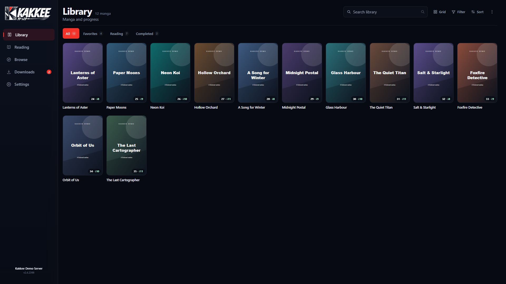

## About

Kakkee reads the library, chapters, sources, downloads, and reading progress through the Suwayomi API.

- **Desktop, tablet, and mobile** layouts with a floating mobile navigation.
- **Cinematic dark, pure black, and snow white** themes with a configurable accent.
- **SFW/NSFW Mode** with a dedicated mode switch and source-based labels.
- **Ghost mode** for reading without writing new history.
- **Server and device downloads**, including an offline reader backed by OPFS.
- **Installable PWA** with an update prompt.

## Screenshots

Desktop screenshots use fictional demo content served by the local fixture server.

### PWA experience

Kakkee installs as a standalone PWA with safe-area aware layouts on iPhone.

<a href="docs/screenshots/pwa/pwa.jpg">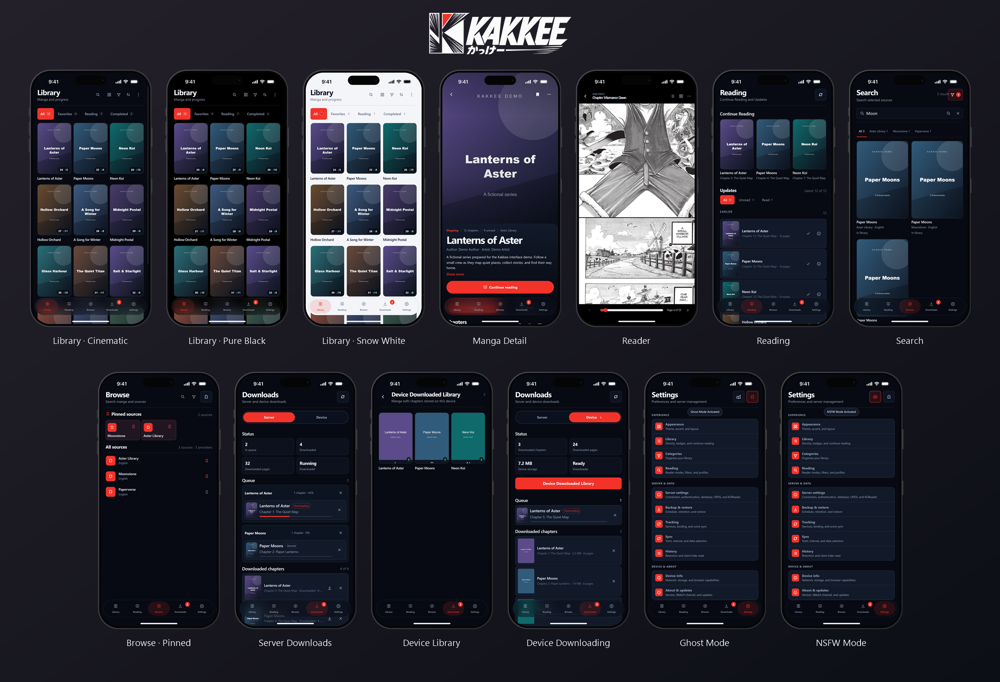</a>

The PWA set covers Library in all three themes, Manga Detail, Reader, Reading, Search, Browse with pinned sources, server downloads, Device Downloaded Library, device downloading, Ghost Mode, and NSFW Mode.

### Three themes

<table>
  <tr>
    <td width="33%"><br><sub>Cinematic Dark</sub></td>
    <td width="33%">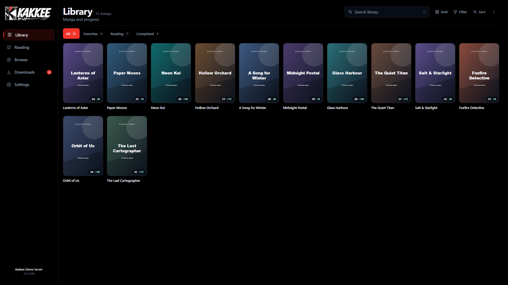<br><sub>Pure Black</sub></td>
    <td width="33%">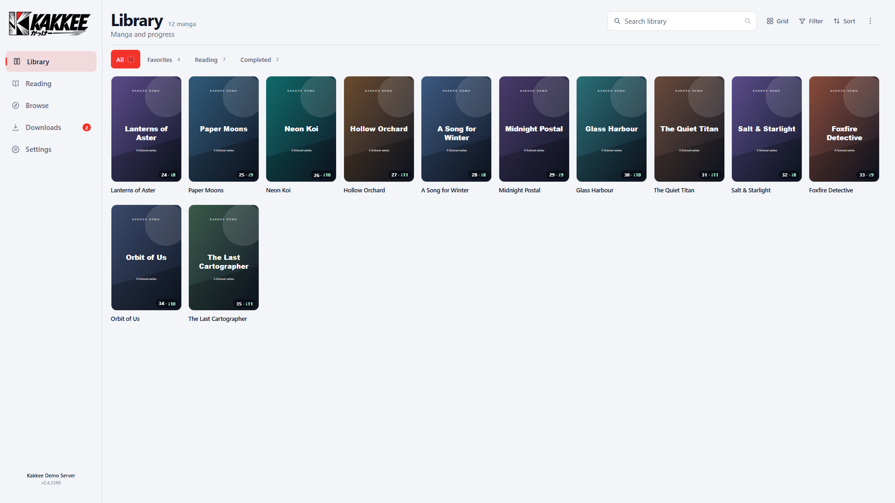<br><sub>Snow White</sub></td>
  </tr>
</table>

### Ghost and NSFW modes

<table>
  <tr>
    <td width="50%">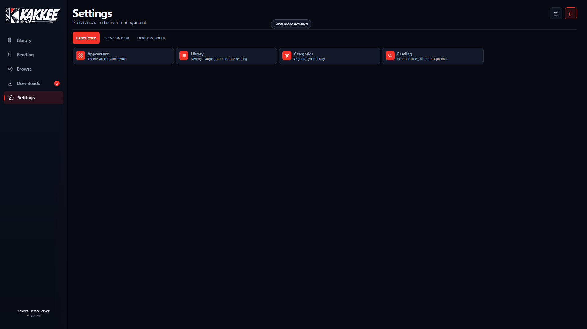<br><sub>Ghost Mode</sub></td>
    <td width="50%">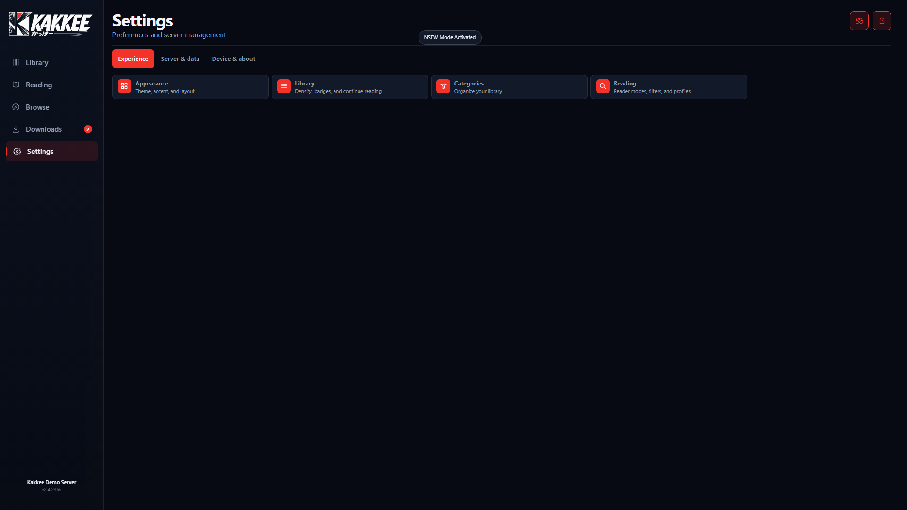<br><sub>NSFW Mode</sub></td>
  </tr>
</table>

### Library, search, and browsing

<table>
  <tr>
    <td width="50%">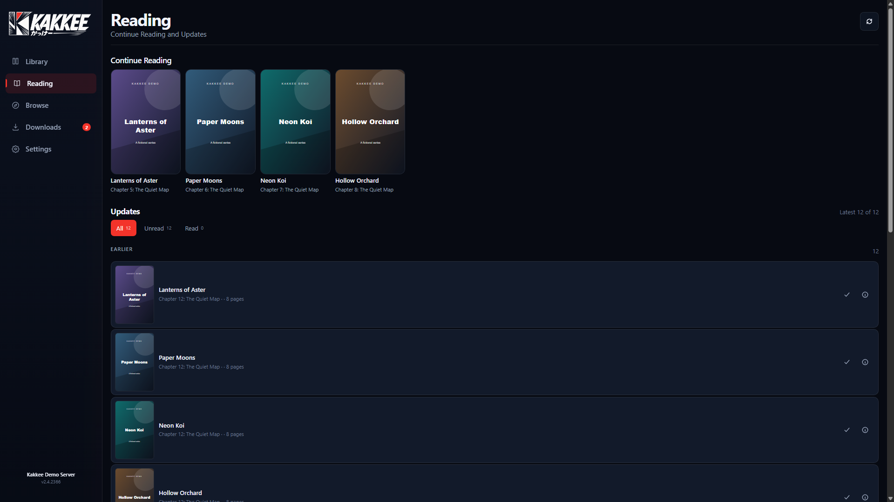<br><sub>Continue Reading</sub></td>
    <td width="50%">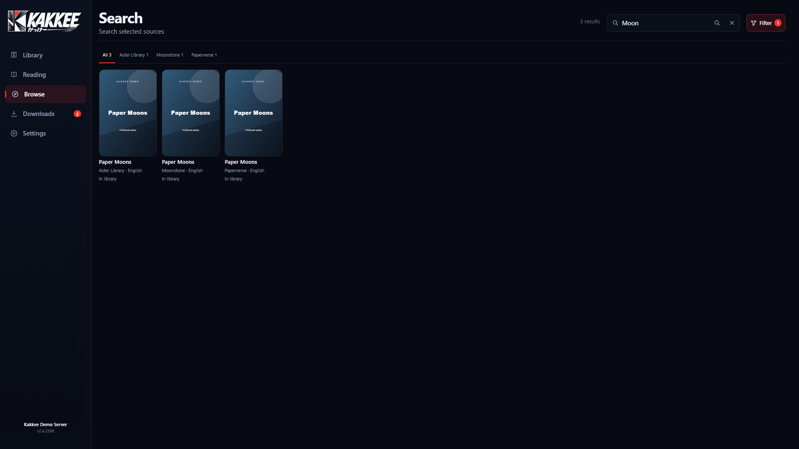<br><sub>Multi-source search</sub></td>
  </tr>
  <tr>
    <td width="50%">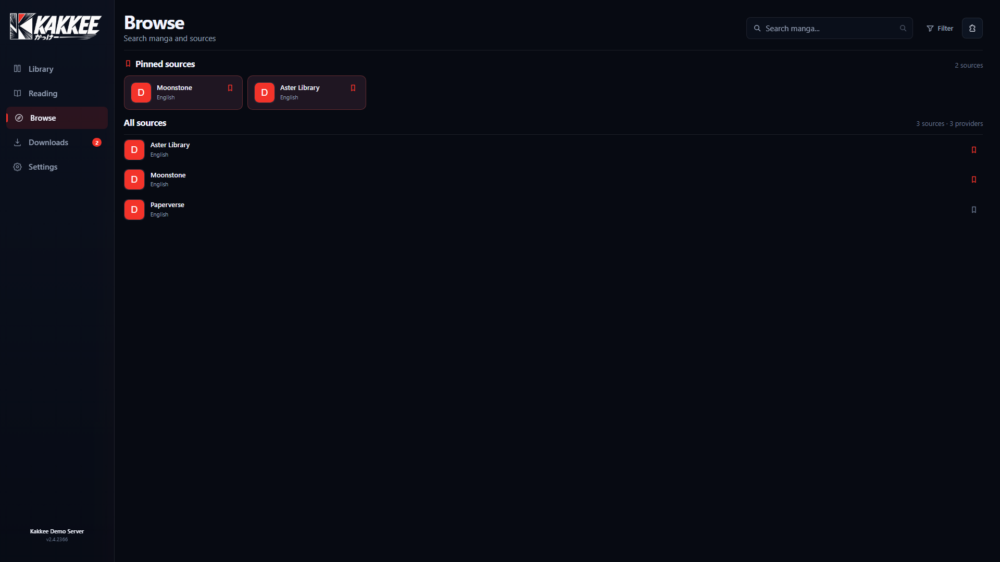<br><sub>Pinned sources</sub></td>
    <td width="50%">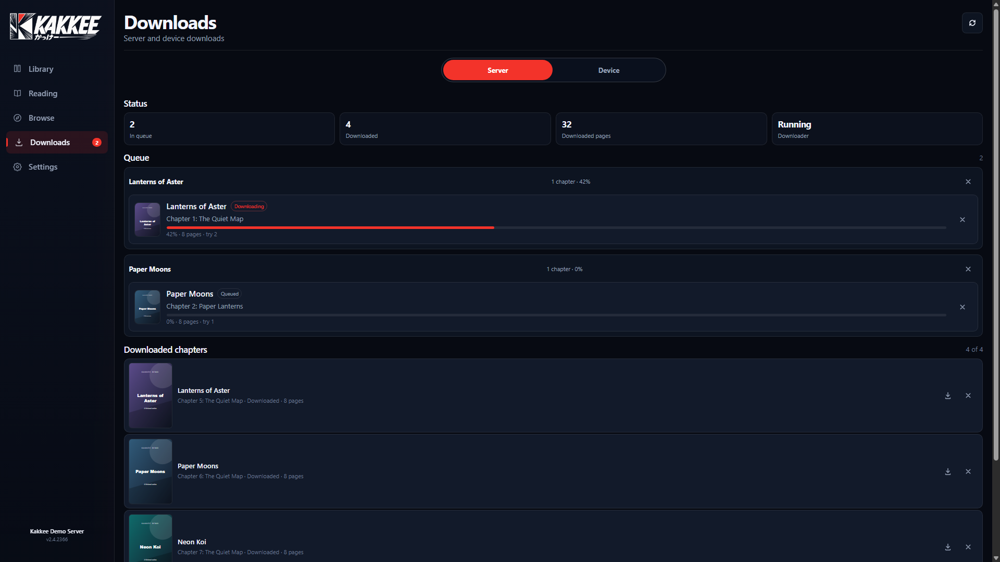<br><sub>Server download queue</sub></td>
  </tr>
</table>

### Detail, reader, and device library

<table>
  <tr>
    <td width="50%">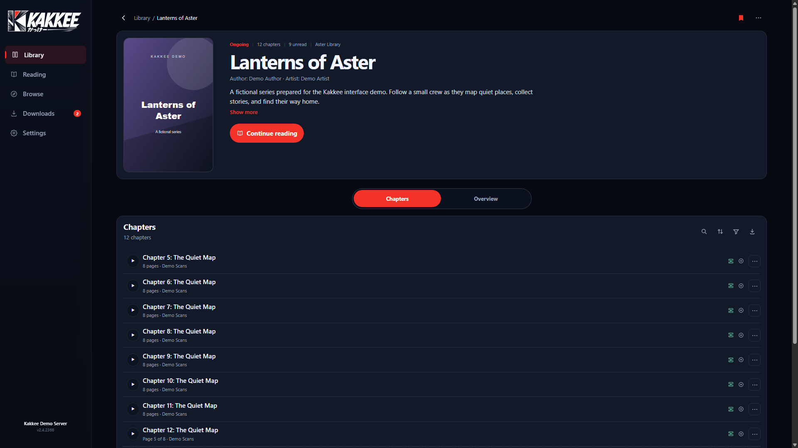<br><sub>Manga Detail</sub></td>
    <td width="50%">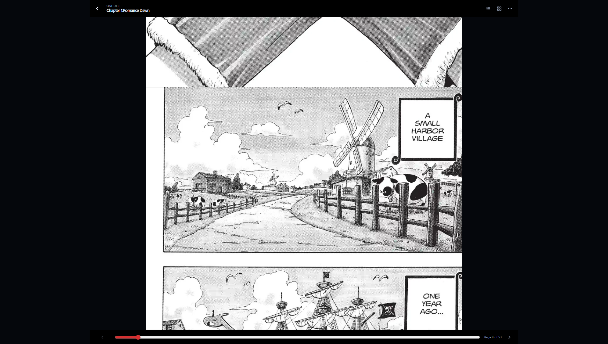<br><sub>Reader</sub></td>
  </tr>
  <tr>
    <td width="50%">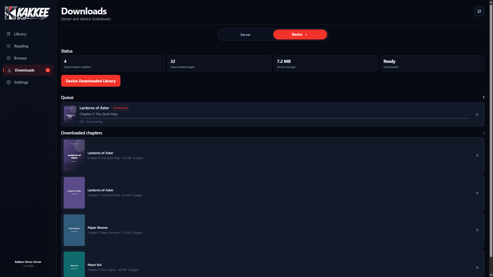<br><sub>Device downloading</sub></td>
    <td width="50%">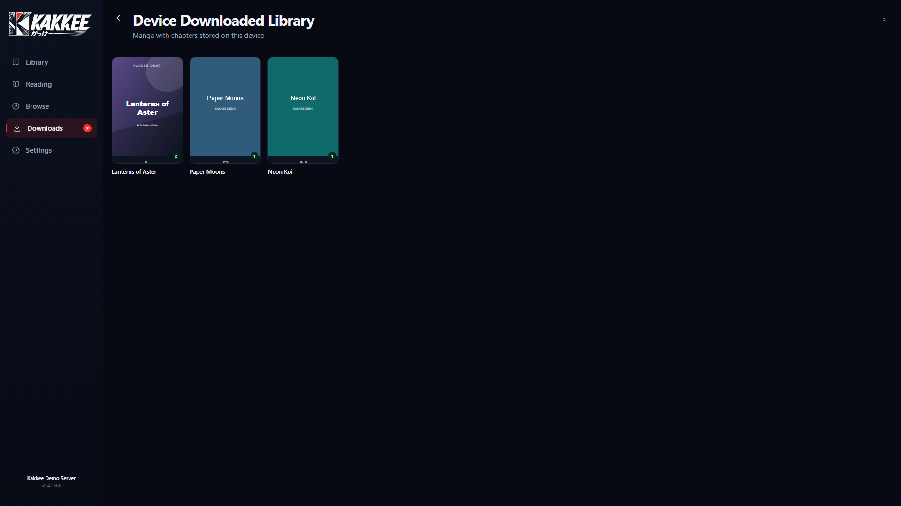<br><sub>Device Downloaded Library</sub></td>
  </tr>
</table>

## Features

### Reading

- Vertical, webtoon, single-page, double-page, and horizontal modes.
- Continuous vertical and webtoon reading that appends the next chapters as you reach the end.
- Exact-page resume, progress writes, and auto-advance when enabled.
- Fit-width, fit-height, screen, and original scaling; small-page stretching.
- Width, gap, background, filter, brightness, contrast, saturation, and direction controls.
- Optional auto background color, duplicate-chapter skipping, keep-screen-on, and auto-scroll.
- Per-manga reading overrides, chapter navigation, bookmarks, and next-chapter downloads.
- "Read next" / "Read last chapter" actions from Manga Detail.

### Library

- Category tabs with real membership counts and category filters.
- Search, source/status filters, sort, grid/list view, and compact/comfortable density.
- Unread and download badges, continue-reading chips, and resumable cards.
- Single, shift-range, and long-press selection for bulk actions.
- Bulk category management, read/unread, download, delete, and duplicate-title tools.
- Automatic source NSFW labels with a local hide/show mode.

### Browse, search, and extensions

- Installed source catalog with language, NSFW, and preferred-language filters.
- Pinned sources, last-used sources, source preferences, and per-source search.
- Popular/latest source browsing with dynamic filters and pagination.
- Global search across the library and installed sources.
- Extension store management, updates, and external JAR upload.

### Downloads and offline

- Server download queue with progress, pause/resume, retry, cancel, and grouping.
- Device downloads stored locally in OPFS with progress and size.
- Offline reading and library management through the device tab.
- Cover thumbnails in the device queue and offline chapter list.

### Server integration

- Supports `NONE`, `UI_LOGIN`, `HTTP Basic`, and `SIMPLE_LOGIN` flows.
- Authenticated resource service for thumbnails and reader pages.
- Tracking, backup/restore, library sync, server settings, and About.
- Same-origin **Suwayomi Custom WebUI** mode with automatic connection.

## Install

### Requirements

- Node.js `22.12+` (or `24+`)
- A reachable Suwayomi Server, tested against `v2.4.2366`

### Ready-to-use build

The [latest release](https://github.com/alphasquare404/kakkee/releases/latest) includes a prebuilt Custom WebUI archive (`.zip` and `.tar.gz`). Download it and follow [Custom WebUI deployment](docs/custom-webui.md); no Node.js build is required.

```bash
git clone https://github.com/alphasquare404/kakkee.git
cd kakkee
npm install
npm run dev
```

Open the Vite URL, enter the Suwayomi server address, and connect. For local development the Vite proxy can forward `/api` to a server:

```bash
SUWAYOMI_SERVER_URL=http://127.0.0.1:4567 npm run dev
```

### Demo fixture data

The screenshots in this README are reproducible without a personal library. The local fixture server returns fictional titles, synthetic covers, reader pages, a server download queue, and device-download data:

```bash
npm run demo
npm run dev
```

The demo server listens on `http://127.0.0.1:4567`, which is the default Vite proxy target. It is a screenshot/demo fixture, not a production server.

### Production build

```bash
npm run build
npm run preview
```

For a standalone deployment, serve `dist/` with an SPA fallback and configure Suwayomi CORS for the frontend origin.

### Suwayomi Custom WebUI

The recommended same-origin setup serves the frontend from Suwayomi itself:

```bash
npm run build:webui
```

Copy the contents of `dist/` into the server's `webUI` directory, set **Settings -> Server -> Web interface -> Interface** to **Custom**, and restart the server. `index.html` must be directly inside `webUI`.

See [Custom WebUI deployment](docs/custom-webui.md) for paths, updates, and cache troubleshooting.

## Themes

- **Cinematic Dark** - deep blue-black surfaces with a cinematic accent.
- **Pure Black** - true black for OLED screens.
- **Snow White** - light surfaces with dark text.

Accent color, library density, and layout preferences are persisted locally. Server data stays on the server.

## Tech stack

- React 19 + TypeScript (strict)
- Vite 8
- React Router 7
- Apollo Client + `graphql-ws`
- Vitest + Testing Library
- `vite-plugin-pwa` and OPFS for offline device storage

## Project structure

```text
src/
|-- app/          router, connection provider, shell, PWA
|-- core/         server, GraphQL, repositories, preferences, offline
|-- features/     library, manga, reader, browse, downloads, settings
`-- shared/       reusable UI and hooks
graphql/          schema snapshot and operations
docs/             architecture, deployment, audits, and feature notes
```

## Quality checks

```bash
npm run lint
npm run typecheck
npm run test
npm run build
```

Current baseline: 475 tests passed, 7 skipped.

## Documentation

- [Architecture](docs/architecture.md)
- [Custom WebUI deployment](docs/custom-webui.md)
- [Reader and Manga Detail](docs/phase-1-manga-reader.md)
- [Offline OPFS storage](docs/offline-opfs.md)
- [Feature parity plan](docs/suwayomi-webui-feature-parity.md)
- [Implemented features](docs/fitur-implemented-id.md)

## Status and limitations

Kakkee is under active development. The server integration and core reading flow are implemented, while some upstream Suwayomi-WebUI features remain parity work. See the feature matrix for the current status.

This project is an independent client. It hosts no manga content and is not affiliated with the content sources or with Suwayomi.

Demo screenshots use fictional content; any third-party artwork shown in the mobile captures belongs to its respective owners.

## License

Kakkee is licensed under the **GNU General Public License v3.0 only** (`GPL-3.0-only`). See [LICENSE](LICENSE).

If you distribute a modified version, you must make the corresponding source code available under the same license. Private/internal modifications do not have to be published unless they are distributed. For network-service copyleft, use AGPL-3.0 instead of GPL-3.0.

